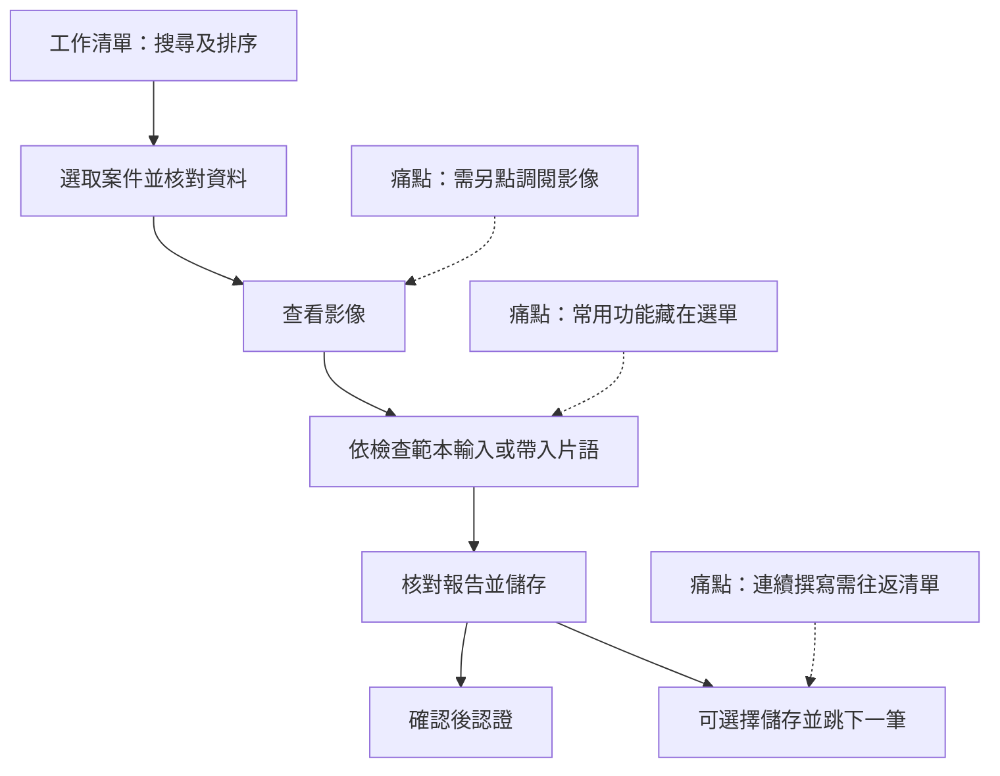

# 影像報告撰寫系統設計

雛型入口：[開啟單頁 HTML](./影像報告撰寫系統_共用清單版.html)。下載後可直接在瀏覽器開啟，不需後端；目前不填寫公開部署網址。

## 1. 使用者研究

### 醫師人物誌

**醫師甲｜放射科報告醫師**。以下是訪談描述，未推定年齡、年資或熟練程度。

| 特質或工作需求 | 訪談出處 |
| --- | --- |
| 使用門診放射、健檢胸部 X 光及健檢乳攝範本 | 訪談一首次，第 2 頁 |
| 需要在清單上方調整搜尋條件，掌握未完成件數與分項 | 訪談一首次與補充，第 2–3 頁 |
| 希望查看影像時可同時撰寫報告，常用功能直接可見 | 訪談一首次與補充，第 3 頁 |
| 希望儲存後可直接處理下一份，不必反覆返回清單 | 訪談一首次與補充，第 3 頁 |

### 醫師任務流程

下圖是依訪談重建的任務，非現場觀察紀錄。乳攝與批次例外見第 4 節。

### 痛點

| 痛點 | 出處 | 對醫師的影響 |
| --- | --- | --- |
| 功能藏在選單 | 訪談一首次，第 3 頁 | 撰寫時要多找一層 |
| 要另點調閱影像 | 訪談一補充，第 3 頁 | 每筆檢查多一道操作 |
| 前後案件需回清單切換 | 訪談一首次，第 3 頁 | 中斷連續撰寫 |
| 擔心報告分派錯誤 | 訪談一補充，第 3 頁 | 需要回查清單；訪談未證實錯誤頻率 |

## 2. 需求矛盾與設計決定

| 議題 | 不一致的說法 | 我的設計決定 | 理由 |
| --- | --- | --- | --- |
| 門診片語 | 醫師首次說不需要，後續更正為需要（第 2–3 頁） | 採後續說法，提供片語 | 保留受訪者明確更正 |
| 已取消醫令 | 放射師希望已照保留、未照移除；超音波技術員希望全部隱藏（第 4 頁） | 目前工作站沿用已照保留並標記、未照隱藏；未另建技術員介面 | 供放射師查閱已照紀錄；技術員的清單規則仍未驗證 |
| 跳下一筆 | 醫師提及片語確認後跳轉、儲存後跳轉（第 3 頁） | 片語只帶入內容；提供明確的「儲存並跳下一筆」 | 避免仍在編輯時離開 |
| 儲存與認證 | 訪談提及兩項操作，未定義兩者關係 | 儲存後可留在本筆，再認證；也可明確選擇儲存並認證 | 避免把儲存誤認為正式簽發 |

## 3. 設計範圍

- **涵蓋：**同一張工作清單上的搜尋、篩選、排序與狀態數量；依目前使用者角色提供報告範本、片語、影像區與 F9、儲存／認證／取消認證，或單筆／批次指派、格式確認與影像狀態更新；乳攝依序判讀及健檢胸部 X 光批次處理。
- **不涵蓋及原因：**目前是單檔前端，沒有 PACS／HIS、實際影像、後端保存、登入授權或真實簽章。操作資料在重新整理後重設。

### 共用清單與權限

共用畫面、篩選與案件資料，不共用角色操作權限。選擇「目前使用者」只切換單檔內的操作身分，不會開啟新的頁面或分頁。

| 操作 | 報告醫師 | 放射師 |
| --- | --- | --- |
| 查看工作清單、搜尋、篩選與排序 | 可以 | 可以 |
| 撰寫與儲存報告 | 自己名下可處理的案件；乳攝須輪到自己 | 不可以 |
| 認證、取消認證及批次認證 | 自己有權處理的報告，依狀態與流程限制 | 不可以 |
| 批次帶入草稿與逐筆核對 | 自己名下符合條件的健檢胸部 X 光 | 不可以 |
| 單筆或批次指派醫師 | 不可以 | 可以，依案件狀態限制 |
| 乳攝第一位、第二位及第三位指派 | 不可以 | 可以，依判讀階段限制 |
| 確認報告格式、更新影像狀態 | 不可以 | 可以 |

### 操作驗證

1. 開啟共用清單，選擇「醫師甲（報告醫師）」：確認沒有指派、格式確認或影像管理按鈕；可開啟自己名下符合條件的報告。
2. 選擇「放射師」：在同一清單出現指派與管理按鈕，報告撰寫和批次認證操作不顯示。
3. 將 R0006 指派給醫師甲，再切回醫師甲：案件資料仍保留，醫師甲可處理該筆報告。
4. R0009 尚無影像：可先由放射師指派，但不能直接撰寫或認證。
5. 重新整理會恢復初始資料。切換身分不會重設案件資料；未儲存內容會先提示確認。

這些是單檔前端操作檢查。正式部署須由後端驗證登入身分與每次操作權限，不能只依賴隱藏按鈕或瀏覽器變數。

## 4. 設計變數與回應

| 收到的變數 | 影響分析 | 回應方式與理由 |
| --- | --- | --- |
| 變數二：乳攝雙人判讀 | 單一指派、報告內容與認證狀態須區分每位醫師與最終報告 | 調整乳攝流程，其他檢查維持原流程。依最後決策由放射師指派兩位，第一位認證後交第二位；兩人都須認證。第二位人工判斷結果是否一致，不自動比較 BI-RADS。若一致，以第二份為最終報告；不同則退回放射師指派第三位。第三位可看前兩份，認證後以第三份作為最終報告。 |
| 變數五：健檢批次處理 | 增加同類報告的重複輸入與認證操作；批次選取可能涵蓋不符條件的案件 | 部分調整：支援兩個獨立操作「批次帶入草稿」與「批次認證」。前者使用固定範本，跳過已有內容；後者僅處理逐筆核對且內容未變更的報告。這可減少輸入與點擊，仍由醫師逐筆判讀；不按多數正常的假設認定任一筆正常。 |
| 變數六：介面合併 | 兩種角色原有各自清單；合併可能混淆撰寫與指派操作 | 部分調整：共用一份搜尋、篩選、排序和表格；清單預設顯示全部案件，可用「報告醫師」篩選；看到案件不代表可以編輯或認證。取消工作站分頁及操作角色下拉切換，共用同一清單與篩選程式，依目前登入使用者的角色顯示操作：報告醫師不可指派，放射師不可撰寫或認證。單檔提供「目前使用者」下拉選單供走查，選擇身分不另開分頁；正式服務必須以後端登入與授權驗證。這回應資訊室降低維護成本的需求，也兼顧醫師甲希望角色操作互不干擾的考量（訪談一補充，第 3 頁）。 |

取消乳攝前序認證時，現行實作使本份與後序認證失效，保留內容為草稿並依序重認證。這是雛型的回流假設。批次功能只處理目前醫師名下、影像狀態可用且未取消／未認證的健檢胸部 X 光，與放射師批次指派分開。

## 5. 設計演進

### 第一版

醫師工作清單與依類別切換的編輯畫面，支援影像示意、片語及儲存後跳下一筆。

### 替代方案與選擇理由

- 工作站配色採奶油白與藕紫；原報告狀態沿用文字與既有語意色，詳細規格見 [設計系統](./design-system.md)。
- 批次操作比較過「只批次草稿」及「草稿與認證分開」，採後者以減少重複操作，同時維持逐筆核對。

### 啟發式評估與設計變數後的修改

增加明顯的填寫入口、切換案件時同步單號、同一畫面完成儲存與認證，依三張變數卡加入依序判讀、批次操作及共用清單，並將介面改為工作站用語。移除工作站分頁，以「目前使用者」對應角色權限；切換身分時維持同一張清單，清除操作選取與批次核對紀錄。

### 可用性測試後的修改

目前紀錄是開發者的流程走查與邏輯檢查，不是醫師或放射師的正式可用性測試。待完成真人測試後再記錄觀察與修改。

### 權限修正（2026-11-11）

- 報告醫師：僅可處理自己名下報告，包含草稿、核對、認證及取消認證；不可指派、確認格式或更新影像狀態。乳攝依目前指定的判讀順序作業。
- 放射師：可單筆／批次指派、確認格式、更新影像狀態，以及指派乳攝第三位；不可撰寫或認證報告。
- 依訪談分工保留權限，共用畫面不等於共享操作權限。本版在函式與送出時也檢查角色；前端檢查不是正式安全邊界，後端授權尚未實作。
